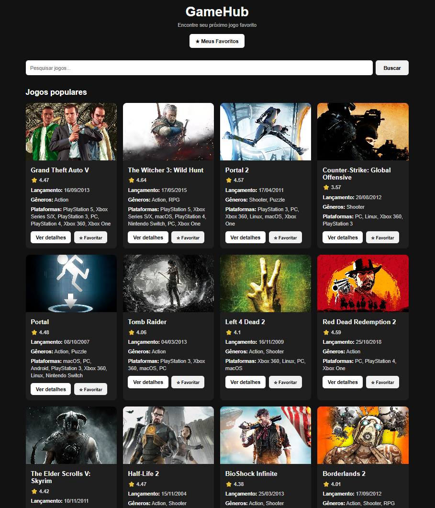

# 🎮 GameHub

O **GameHub** é uma aplicação web desenvolvida com React que consome a RAWG API para exibir informações sobre diversos jogos.

Com uma interface moderna e responsiva, o projeto permite pesquisar jogos, visualizar detalhes e salvar os favoritos diretamente no navegador.

## 🌐 Projeto online

🔗 **Acesse o GameHub:** https://catalogo-jogos-catalogo-jogos-one.vercel.app/

## 📸 Preview do projeto



## 🚀 Funcionalidades

- 🔎 Buscar jogos por nome
- 🎮 Listar jogos populares
- 🖼️ Visualizar capas e imagens dos jogos
- ⭐ Consultar notas e avaliações
- 📅 Visualizar datas de lançamento
- 🏷️ Consultar gêneros e plataformas
- 📄 Acessar uma página com detalhes de cada jogo
- 🏢 Visualizar desenvolvedoras e notas do Metacritic
- ❤️ Adicionar jogos aos favoritos
- 💾 Salvar favoritos no LocalStorage
- 📋 Visualizar uma página exclusiva de favoritos
- ❌ Remover jogos dos favoritos
- 📱 Interface responsiva

## 🛠️ Tecnologias utilizadas

- React
- JavaScript
- HTML5
- CSS3
- React Router DOM
- Vite
- RAWG API
- LocalStorage
- Git e GitHub

## 🔗 API utilizada

O projeto utiliza a **RAWG Video Games Database API** para obter informações sobre jogos, incluindo imagens, gêneros, plataformas, datas de lançamento e avaliações.

Site oficial: https://rawg.io/apidocs

## 📂 Estrutura do projeto

```text
catalogo-jogos/
├── public/
│   ├── favicon
│   ├── icons
│   └── preview.png
├── src/
│   ├── pages/
│   │   ├── Home.jsx
│   │   ├── GameDetails.jsx
│   │   └── Favorites.jsx
│   ├── App.jsx
│   ├── App.css
│   ├── index.css
│   └── main.jsx
├── package.json
└── vite.config.js
```

## 💻 Como executar o projeto localmente

1. Clone o repositório:

   ```bash
   git clone https://github.com/lucasroque963/catalogo-jogos.git
   ```

2. Entre na pasta do projeto:

   ```bash
   cd catalogo-jogos/catalogo-jogos
   ```

3. Instale as dependências:

   ```bash
   npm install
   ```

4. Configure sua chave da RAWG API em um arquivo `.env`, utilizando a variável esperada pelo projeto:

   ```env
   VITE_RAWG_API_KEY=sua_chave_aqui
   ```

5. Inicie a aplicação:

   ```bash
   npm run dev
   ```

## 🎯 Objetivo do projeto

Este projeto foi desenvolvido para praticar e aprimorar conhecimentos em desenvolvimento front-end, consumo de APIs, gerenciamento de rotas, armazenamento local e criação de interfaces responsivas com React.

## 👨‍💻 Desenvolvido por

**Lucas Roque de Medeiros**

🔗 GitHub: https://github.com/lucasroque963

🔗 Projeto online: https://catalogo-jogos-catalogo-jogos-one.vercel.app/
